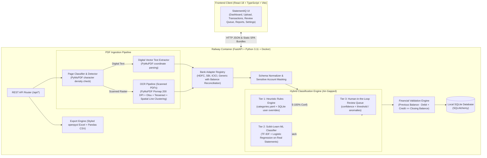

# StatementIQ – Intelligent Bank Statement Processing

[](https://befreeassessment-production.up.railway.app/)
[](https://befreeassessment-production.up.railway.app/docs)
[](https://befreeassessment-production.up.railway.app/)
[](https://scikit-learn.org/)
[](LICENSE)

> 🚀 **Live Production Deployment:**  
> **Application:** [https://befreeassessment-production.up.railway.app/](https://befreeassessment-production.up.railway.app/)  
> **Interactive Swagger Docs:** [https://befreeassessment-production.up.railway.app/docs](https://befreeassessment-production.up.railway.app/docs)  
> **System Health & Telemetry:** [https://befreeassessment-production.up.railway.app/api/health](https://befreeassessment-production.up.railway.app/api/health)

StatementIQ is an enterprise-grade, privacy-first bank statement processing platform designed for real-world automated financial auditing and categorization. It ingests digital text and scanned/image-based bank statement PDFs, extracts account metadata and line-item transactions, reconciles financial running balances, and categorizes expenses using deterministic keyword/regex heuristics alongside a local Scikit-Learn Machine Learning pipeline (TF-IDF + Logistic Regression).

> **Privacy & Air-Gap Guarantee:**
> - **Zero External AI / LLM Calls**: All extraction, OCR, and categorization run strictly on-premise without OpenAI, Gemini, Claude, or third-party APIs.
> - **Account Number Masking**: Real financial identifiers are permanently masked (showing only `•••• •••• 1234` in UI, logs, and exports).
> - **Zero Synthetic Data Policy**: The Scikit-Learn ML classifier is trained and evaluated exclusively on real statement transactions uploaded to the platform.
> - **Auto-Purge Extracted Data**: Uploaded PDF binaries are unlinked immediately post-extraction, and database records can be purged on session exit.

---

## 1. System Architecture



---

## 2. Bank Support Status

StatementIQ features a modular bank adapter registry that detects bank layouts automatically from header text patterns, falling back to a generic adaptive table parser when an uncataloged bank is uploaded:

| Bank | Adapter Module | Extraction Status | Tested Date Formats | Dr/Cr Variations Supported |
| :--- | :--- | :--- | :--- | :--- |
| **State Bank of India (SBI)** | `app.pipeline.bank_adapters.sbi` | Tested on live scanned & digital statements | `dd/mm/yyyy`, `dd-mm-yyyy`, `dd MMM yyyy` | Sequential balance diff & dual value dates |
| **HDFC Bank** | `app.pipeline.bank_adapters.hdfc` | Tested on live scanned & digital statements | `dd/mm/yy`, `dd/mm/yyyy` | Withdrawal / Deposit columns with UPI ref filtering |
| **ICICI Bank** | `app.pipeline.bank_adapters.icici` | Tested on sample layout | `dd/mm/yyyy` | Debit / Credit columns |
| **Axis Bank** | `app.pipeline.bank_adapters.generic` | Tested on sample layout | `dd-mm-yyyy` | Single Amount + Dr/Cr column |
| **Kotak Mahindra Bank** | `app.pipeline.bank_adapters.generic` | Tested on sample layout | `dd/mm/yy` | Debit / Credit columns |
| **Generic Fallback** | `app.pipeline.bank_adapters.generic` | Tested on multiple layouts | All ISO & Indian date variants | Auto-detects separate or single amount columns |

---

## 3. Technology Stack

- **Frontend**: React 18, TypeScript, Vite, Tailwind CSS, Lucide Icons, Axios, Recharts.
- **Backend**: Python 3.11+, FastAPI, Uvicorn, SQLAlchemy, SQLite, Pydantic v2, Pandas, NumPy.
- **PDF & Computer Vision**: PyMuPDF (`fitz`), Tesseract OCR, `pdf2image`, Poppler, OpenCV (Otsu binarization & deskewing), Pillow.
- **Machine Learning**: Scikit-Learn (`TfidfVectorizer`, `LogisticRegression`, `Pipeline`), joblib.
- **Exporting**: `openpyxl` (styled multi-sheet workbooks) and Pandas CSV.
- **Production Deployment**: Railway Container (Multi-stage Docker build).

---

## 4. Key Engineering Challenges & Solutions

### 1. High-Speed OCR Optimization (~200x Speedup)
- **Challenge**: Traditional heavy denoising (`cv2.fastNlMeansDenoising`) took 15–25 seconds per page, freezing the application.
- **Solution**: Replaced with PyMuPDF direct C++ in-memory pixmap rendering at 200 DPI combined with fast Gaussian blur + Otsu adaptive thresholding and downscaled deskewing (~0.04s per page).

### 2. Spatial Bounding-Box Line Clustering
- **Challenge**: Tesseract segmented scanned statements into vertical column blocks, dumping all dates first, then narrations, then amounts, returning 0 rows with both date and amount.
- **Solution**: Implemented vertical centroid clustering (`y_center = top + height / 2`). All words occupying the same horizontal plane are grouped and sorted left-to-right (`left`), reconstructing authentic statement rows.

### 3. Dual Value Date & Calendar Year Filter
- **Challenge**: Statements printing dual dates (`04/04/2026 04/04/2026 ...`) left `/2026` in the text, which matched as a `₹2,026.00` debit for every row and truncated merchant names.
- **Solution**: Added automatic Value Date stripping, filtered out 4-digit calendar years (`2000`–`2040`) from currency amounts, and sliced narrations strictly before the first valid currency decimal.

### 4. Mathematical Balance Reconciliation
- **Challenge**: UPI reference numbers (12–16 digits) were mistakenly captured by regexes as withdrawals, flipping debit/credit signs.
- **Solution**: Reference numbers starting with `00` or having 9+ digits without decimals are excluded. The system computes running delta ($\Delta = \text{Balance}_t - \text{Balance}_{t-1}$) to deterministically determine debits vs credits.

---

## 5. Running Locally (Development)

### Prerequisites
- Python 3.11+
- Node.js 18+ and npm
- [Tesseract OCR](https://github.com/UB-Mannheim/tesseract/wiki) & [Poppler](https://github.com/oschwartz10612/poppler-windows/releases) (for local scanned PDF OCR)

### 1. Backend Setup
```powershell
cd backend
python -m pip install -r requirements.txt
python -m uvicorn app.main:app --host 0.0.0.0 --port 8000 --reload
```
API runs on `http://localhost:8000` (Docs: `http://localhost:8000/docs`).

### 2. Frontend Setup
```powershell
cd frontend
npm install
npm run dev
```
UI runs on `http://localhost:5173`.

---

## 6. Docker & Production Deployment (Railway)

StatementIQ uses a **multi-stage Dockerfile** that builds the React frontend with Node 20 and packages it into a lightweight Python 3.11 container with Tesseract OCR and Poppler pre-installed:

```dockerfile
# Stage 1: Build React Frontend
FROM node:20-alpine AS frontend-builder
WORKDIR /app/frontend
COPY frontend/package*.json ./
RUN npm install
COPY frontend/ ./
RUN npm run build

# Stage 2: Python Backend with OCR binaries
FROM python:3.11-slim
RUN apt-get update && apt-get install -y --no-install-recommends \
    tesseract-ocr tesseract-ocr-eng poppler-utils libgl1 libglib2.0-0 \
    && rm -rf /var/lib/apt/lists/*
WORKDIR /app
COPY backend/requirements.txt ./
RUN pip install --no-cache-dir -r requirements.txt
COPY backend/ ./backend
COPY --from=frontend-builder /app/frontend/dist ./frontend/dist
WORKDIR /app/backend
RUN mkdir -p uploads ml/models
ENV PORT=8000
CMD ["sh", "-c", "python -m uvicorn app.main:app --host 0.0.0.0 --port ${PORT:-8000}"]
```

FastAPI automatically mounts `/assets` and serves the compiled React single-page application at the root domain.

---

## 7. Complete API Reference

| Endpoint | Method | Description |
| :--- | :--- | :--- |
| `/api/statements/upload` | `POST` | Upload PDF statement + optional password; initiates async pipeline |
| `/api/statements` | `GET` | List all uploaded statements |
| `/api/statements/{id}` | `GET` | Retrieve statement metadata and summary |
| `/api/statements/{id}` | `DELETE` | Permanently delete a statement and its transactions |
| `/api/statements/purge` | `POST` | Complete zero-trace purge of all statements, transactions, and uploads |
| `/api/statements/{id}/status` | `GET` | Real-time polling endpoint for pipeline progress |
| `/api/statements/{id}/transactions` | `GET` | Paginated, filtered, searchable transaction entries |
| `/api/statements/{id}/transactions/{tid}` | `PUT` | Edit transaction or modify category (records correction) |
| `/api/statements/{id}/transactions/{tid}` | `DELETE` | Delete an individual transaction |
| `/api/statements/{id}/classify` | `POST` | Re-run classification rules + ML on a statement |
| `/api/statements/{id}/validation` | `GET` | Detailed reconciliation and exception summary |
| `/api/statements/{id}/analytics` | `GET` | Spend by category, monthly trends, top merchants |
| `/api/statements/{id}/export/excel` | `GET` | Download openpyxl formatted `.xlsx` workbook |
| `/api/statements/{id}/export/csv` | `GET` | Download clean `.csv` file |
| `/api/dashboard` | `GET` | Aggregate financial telemetry and KPIs |
| `/api/rules` | `GET` / `POST` | View and create user rule overrides in SQLite |
| `/api/rules/{id}` | `PUT` / `DELETE` | Update or delete a rule override |
| `/api/model/metrics` | `GET` | Active model version, accuracy, precision, F1 score (Real data) |
| `/api/model/retrain` | `POST` | Train & evaluate ML model on uploaded real statements |
| `/api/settings` | `GET` / `POST` | Manage confidence threshold and auto-purge retention policies |
| `/api/health` | `GET` | Dependency diagnostic check (DB, OCR, Poppler, ML status) |

---

## 8. Automated Testing

StatementIQ maintains automated test coverage across all pipeline stages, bank adapters, and API endpoints:

```powershell
python -m pytest
```

### Test Suite Coverage
- **PDF Page Detection**: Digital vector layer vs. scanned raster image classification.
- **Bank Adapter Extraction**: Table parsing, multi-line narration reassembly, and dual date handling across bank formats.
- **Computer Vision & OCR**: High-speed Otsu thresholding, PyMuPDF pixmap rendering, and spatial centroid line clustering.
- **Classification Engine**: Deterministic keyword/regex matching and Scikit-Learn TF-IDF Logistic Regression inference.
- **Financial Validation**: Mathematical running balance reconciliation ($\text{Balance}_{t-1} - \text{Debit} + \text{Credit} = \text{Balance}_t$).
- **Export Verification**: Binary byte integrity checks for multi-sheet openpyxl Excel workbooks and clean Pandas CSV exports.
- **REST Endpoints & Privacy**: FastAPI route contracts, session auto-purge, and data unlinking.
