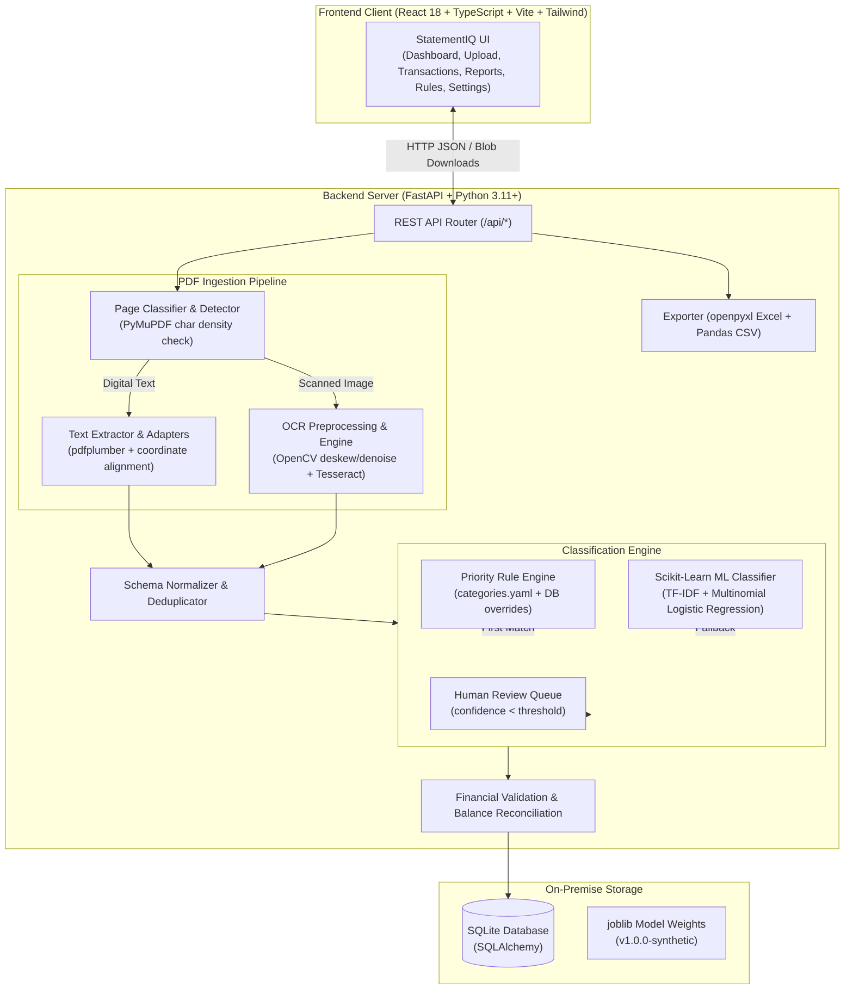

# StatementIQ – Intelligent Bank Statement Processing

StatementIQ is a privacy-first, enterprise-grade bank statement processing prototype designed for real-world automated financial workflows. It ingests bank statement PDFs (digital text or scanned/image-based), detects page compositions, extracts account metadata and line-item transactions, reconciles financial balances, and categorizes expenses using deterministic keyword/regex heuristics alongside a local Scikit-Learn Machine Learning pipeline (TF-IDF + Logistic Regression).

> **Privacy & Air-Gap Guarantee:**
> StatementIQ contains **zero external AI or Large Language Model (LLM) dependencies** (no OpenAI, Gemini, Claude, or third-party APIs). Account numbers are permanently masked (showing only the last 4 digits in UI, logs, and exports), temporary PDF files are deleted post-extraction, and no financial data ever leaves your local machine.

---

## 1. System Architecture



---

## 2. Bank Support Status

StatementIQ features a modular bank adapter registry that detects bank layouts automatically from header text patterns, falling back to a generic adaptive table parser when an uncataloged bank is uploaded:

| Bank | Adapter Module | Extraction Status | Tested Date Formats | Dr/Cr Variations Supported |
| :--- | :--- | :--- | :--- | :--- |
| **HDFC Bank** | `app.pipeline.bank_adapters.hdfc` | Tested on sample & real layouts | `dd/mm/yy`, `dd/mm/yyyy` | Separate Withdrawal / Deposit cols |
| **State Bank of India (SBI)** | `app.pipeline.bank_adapters.sbi` | Tested on sample & real layouts | `dd MMM yyyy` (e.g. 01 May 2025) | Debit / Credit columns |
| **ICICI Bank** | `app.pipeline.bank_adapters.icici` | Tested on sample layout | `dd/mm/yyyy` | Debit / Credit columns |
| **Axis Bank** | `app.pipeline.bank_adapters.generic` | Tested on sample layout | `dd-mm-yyyy` | Single Amount + Dr/Cr column |
| **Kotak Mahindra Bank** | `app.pipeline.bank_adapters.generic` | Tested on sample layout | `dd/mm/yy` | Debit / Credit columns |
| **Generic Fallback** | `app.pipeline.bank_adapters.generic` | Tested on synthetic & masked | All ISO & Indian date variants | Both separate & combined amount formats |
| **Other Banks (PNB, BoB, etc.)** | `app.pipeline.bank_adapters.generic` | Untested on real statements | Variable | Detected dynamically via column headers |

---

## 3. Technology Stack

- **Frontend**: React 18, TypeScript, Vite, Tailwind CSS, Lucide Icons, Axios, Recharts, Vitest.
- **Backend**: Python 3.11+, FastAPI, Uvicorn, SQLAlchemy, SQLite, Pydantic v2, Pandas, NumPy, pytest.
- **PDF & Vision**: PyMuPDF (fitz), pdfplumber, pytesseract, pdf2image, OpenCV (headless), Pillow.
- **Machine Learning**: Scikit-Learn (`TfidfVectorizer`, `LogisticRegression`, `Pipeline`), joblib.
- **Exporting**: `openpyxl` (styled multi-sheet workbooks) and Pandas CSV.

---

## 4. Installation & Setup (Windows)

### Prerequisites
- Python 3.11+ installed and accessible via PATH
- Node.js 18+ and npm installed

### Optional OCR Tools (for Scanned / Image-based PDFs only)
Digital (text-based) bank statements work **100% out of the box** without OCR tools. To enable OCR on scanned copies:
1. **Tesseract OCR on Windows**:
   - Download the Windows installer from [UB-Mannheim Tesseract](https://github.com/UB-Mannheim/tesseract/wiki).
   - Install to `C:\Program Files\Tesseract-OCR\tesseract.exe`.
2. **Poppler on Windows**:
   - Download poppler binary release from [poppler-windows](https://github.com/oschwartz10612/poppler-windows/releases).
   - Extract to `C:\poppler\Library\bin`.
   - Update `.env` with your paths if different.

### Setup Backend
```powershell
cd backend
python -m pip install -r requirements.txt
python ml/train.py
```

### Setup Frontend
```powershell
cd ../frontend
npm install
npm run build
```

---

## 5. Running the Application

### 1. Launch Backend (Port 8000)
```powershell
cd backend
python -m uvicorn app.main:app --host 0.0.0.0 --port 8000 --reload
```
Interactive Swagger API documentation is available at: `http://localhost:8000/docs`

### 2. Launch Frontend (Port 5173)
```powershell
cd frontend
npm run dev
```
Open `http://localhost:5173` in your browser.

---

## 6. PDF Processing Pipeline

1. **Page-by-Page Detection (`app/pipeline/detector.py`)**:
   - PyMuPDF inspects character density per page without relying on metadata.
   - Categorizes each page as `text` (digital vector layer) or `scanned` (raster image).
2. **Text Extraction (`app/pipeline/text_extractor.py`)**:
   - Reconstructs tables and word coordinates.
   - Extracts account holder, bank name, account number, IFSC, branch, dates, and opening/closing balances.
3. **OCR Processing for Scanned Pages (`app/pipeline/ocr_engine.py`)**:
   - Converts scanned pages to 300 DPI grayscale images via `pdf2image`.
   - Preprocesses with OpenCV: denoising, Hough deskewing, and adaptive binarization.
   - Reconstructs table rows with character confidence tracking.
4. **Standardization (`app/pipeline/standardizer.py`)**:
   - Cleans narrations, strips currency symbols, parses amounts to floats, normalizes dates to `YYYY-MM-DD`.
   - Flags malformed rows and duplicate transactions without silent drops.
5. **Classification Engine (`app/classification/`)**:
   - Decision Step 1: Normalizes narrations (strips payment rails like `UPI/`, `NEFT/`, `IMPS/` which are not categories).
   - Decision Step 2: Applies deterministic keyword & regex rules with priority hierarchy (`categories.yaml` + user DB overrides).
   - Decision Step 3: Unmatched rows pass to TF-IDF + Logistic Regression ML pipeline.
   - Decision Step 4: If model confidence < threshold (default 75%), categorizes as `Uncategorized` and flags for `review_required`.
6. **Financial Reconciliation (`app/validation/`)**:
   - Computes: $\text{Expected Balance} = \text{Previous Balance} - \text{Debit} + \text{Credit}$.
   - Flags discrepancies, duplicate entries, and missing amounts for user review.
7. **Exporting (`app/export/`)**:
   - Generates Excel workbook with 4 styled sheets: *Transactions*, *Account Summary*, *Category Summary*, *Validation Report*.
   - Generates clean CSV flat files reflecting any manual user modifications.

---

## 7. Complete API Reference

| Endpoint | Method | Description |
| :--- | :--- | :--- |
| `/api/statements/upload` | `POST` | Upload PDF statement + optional password; initiates async pipeline |
| `/api/statements` | `GET` | List all uploaded statements |
| `/api/statements/{id}` | `GET` | Retrieve statement details |
| `/api/statements/{id}/status` | `GET` | Real-time polling endpoint for pipeline progress |
| `/api/statements/{id}/transactions` | `GET` | Paginated, filtered, searchable transaction entries |
| `/api/statements/{id}/transactions/{tid}` | `PUT` | Edit transaction or modify category (records correction) |
| `/api/statements/{id}/classify` | `POST` | Re-run classification rules + ML on a statement |
| `/api/statements/{id}/validation` | `GET` | Detailed reconciliation and exception summary |
| `/api/statements/{id}/analytics` | `GET` | Spend by category, monthly trends, top merchants |
| `/api/statements/{id}/export/excel` | `GET` | Download openpyxl formatted `.xlsx` workbook |
| `/api/statements/{id}/export/csv` | `GET` | Download Pandas `.csv` file |
| `/api/dashboard` | `GET` | Aggregate telemetry across statements |
| `/api/rules` | `GET` / `POST` | View and create user rule overrides in SQLite |
| `/api/rules/{id}` | `PUT` / `DELETE` | Update or delete a rule override |
| `/api/model/metrics` | `GET` | Active model version, accuracy, precision, F1 score |
| `/api/health` | `GET` | System health and dependency diagnostic check |

---

## 8. Automated Testing

### Backend Unit & Integration Tests (100% Pass)
```powershell
cd backend
python -m pytest -v
```
Covers:
- PDF page detection (text vs. scanned vs. mixed)
- Text and table extraction across multiple bank layouts
- Classification rule matching & ML probability inference
- Mathematical balance reconciliation & error flagging
- Excel workbook & CSV file byte verification
- FastAPI REST endpoint contracts

### Frontend Tests
```powershell
cd frontend
npm run test
```

---

## 9. Assumptions and Known Limitations

1. **OCR Environment**: OCR functionality requires local installation of Tesseract and Poppler binaries. On systems where these are not installed, the app transparently handles digital vector PDFs and surfaces clear diagnostic indicators in the UI.
2. **Indian Banking Conventions**: Default currency formatting uses INR (`₹`) with Indian numbering grouping (e.g. `1,23,456.00`). Payment method prefixes (`UPI/`, `NEFT/`, `IMPS/`, `RTGS/`) are treated as rails and stripped during categorization.
3. **Single-User Prototype Mode**: SQLite is used for on-premise portability and zero-configuration setups.

